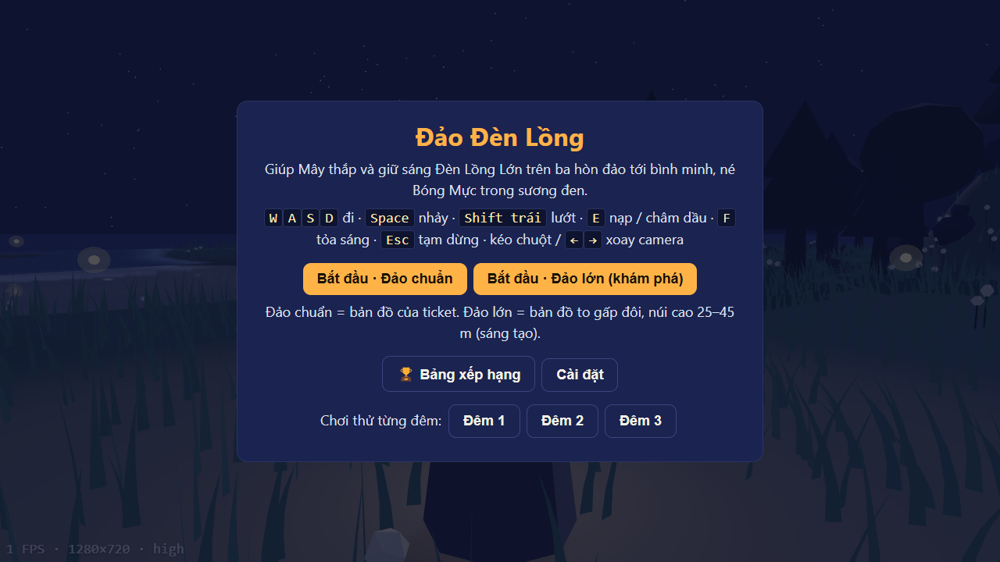
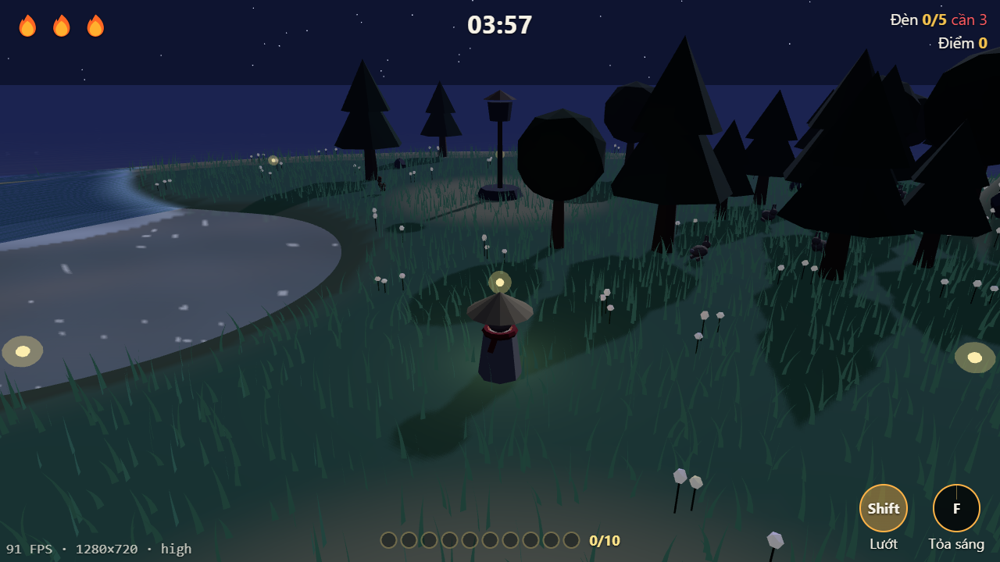
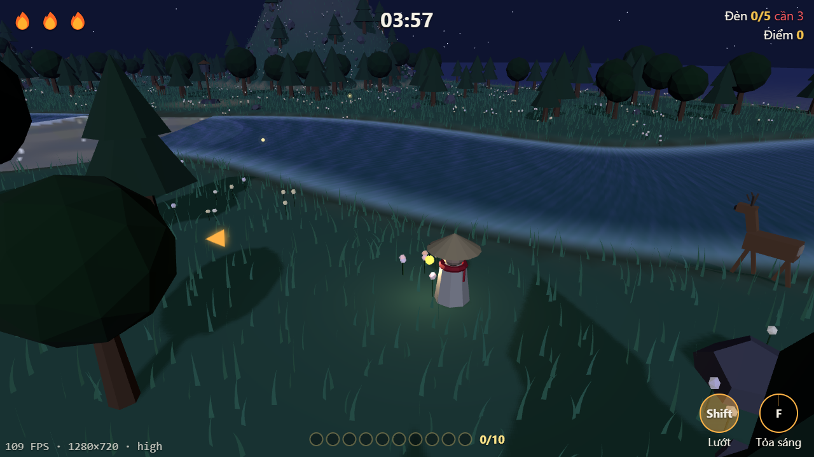

# Đảo Đèn Lồng

> **Video demo:** _(đính kèm GitHub Release `v1.0.0` hoặc `docs/demo/demo.mp4`; link sẽ đặt ở đây khi quay xong)_



Game 3D góc nhìn thứ ba. **Mây**, người giữ đèn nhỏ tuổi, thắp và giữ sáng các **Đèn Lồng Lớn** trên ba hòn đảo
(Đảo Bến, Đảo Cau, Đảo Chuông) cho tới **bình minh**, né **Bóng Mực** đang hút dầu đèn và **Gió Lạc** đang cướp đom đóm.
TypeScript + Three.js (chạy trong trình duyệt), logic game chạy headless bằng Node theo **Test Contract v1.3**.

| | |
|---|---|
|  |  |
| Đêm 1 (đảo chuẩn): HUD, thanh đom đóm, hồi chiêu | Chế độ "Đảo lớn": sông 18 m, núi tuyết, hươu |

Đề bài: [docs/lab/](docs/lab/README.md) · Spec, giả định, acceptance criteria: [docs/notes/assumptions.md](docs/notes/assumptions.md) ·
Quyết định thiết kế: [docs/adr/](docs/adr/0001-lantern-fuel-and-dawn-win.md) · Thay đổi: [CHANGELOG.md](CHANGELOG.md) ·
Bằng chứng: [phase-1](docs/proof/phase-1/README.md), [phase-2](docs/proof/phase-2/README.md), [phase-3](docs/proof/phase-3/README.md), [phase-4](docs/proof/phase-4/README.md) ·
Nhật ký AI: [docs/notes/ai-log.md](docs/notes/ai-log.md) · Retro: [docs/notes/retro.md](docs/notes/retro.md)

## Yêu cầu hệ thống

- **Node.js ≥ 18** (đã thử Node 22). macOS, Linux hoặc Windows.
- Trình duyệt có **WebGL2** (Chrome, Edge, Firefox, Safari mới). Khuyến nghị GPU rời hoặc iGPU đời gần đây; máy yếu dùng `?quality=low`.
- Bench cần thêm Chrome do `puppeteer` tải về (phụ thuộc tuỳ chọn; game không cần).

## Cài đặt và chạy (3 lệnh)

```bash
npm ci            # 1. cài thư viện
npm run build     # 2. build headless + công cụ + bản web (dist/)
npm start         # 3. mở http://localhost:4173 (máy yếu: http://localhost:4173/?quality=low)
```

Hoặc dùng bản phát hành (chỉ cần Node, không cần `npm`): tải `dao-den-long-v1.0.0.tar.gz` ở trang Release rồi
`tar -xzf dao-den-long-v1.0.0.tar.gz && cd dao-den-long-v1.0.0 && node serve.cjs`.

## Điều khiển

Mọi phím đều **đổi được** ở *Cài đặt → Phím* (có cảnh báo trùng phím, nút *Khôi phục mặc định*, được lưu).

| Phím mặc định | Hành động |
|---|---|
| `W A S D` | Di chuyển (theo hướng camera) |
| Kéo chuột / `←` `→` | Xoay camera |
| `Space` | Nhảy |
| `Shift` | Lướt |
| `E` | Nạp đom đóm vào đèn / thắp lại / châm dầu |
| `F` | Tỏa Sáng: làm choáng và đẩy lùi Bóng Mực, xua Gió Lạc (tốn 3 đom đóm) |
| `Esc` hoặc nút **← Quay lại** (góc dưới trái) | Tạm dừng (Tiếp tục / Chơi lại Đêm / Cài đặt / Về menu); ở Cài đặt, Bảng xếp hạng, màn giới thiệu thì quay lại màn trước |

## Luật và cách tính điểm

- Ba Đêm liên tiếp: 240 / 270 / 300 giây, có 5 / 6 / 7 đèn. Mây có **3 Ngọn Lửa** (hồi đầy mỗi Đêm), tự nhặt đom đóm khi đi qua.
  Sức chứa bắt đầu 10, **+2 sau mỗi lần thắp thành công**, tối đa 20.
- Đèn cần **10 đom đóm** để thắp lần đầu, **5** để thắp lại. Đèn sáng có **100 dầu**, cháy 1 dầu/giây. Bấm `E` ở đèn đang sáng để **châm dầu** (mỗi đom đóm +10).
- Đèn sáng có vùng an toàn 6 m. **Dầu dưới 30 thì mất vùng an toàn** và Bóng Mực tới **hút dầu** (5 dầu/giây). Hết dầu thì đèn tắt.
- **Thắng lúc bình minh**: còn sống và còn ít nhất 3/5, 4/6, 5/7 đèn đang sáng. Thắp đủ đèn sớm không kết thúc Đêm.
- Bị Bóng Mực chạm: mất 1 lửa, rơi một nửa đom đóm đang mang (nhặt lại được trong 8 giây). Rơi khỏi đảo: mất 1 lửa và toàn bộ đom đóm.
- Gió Lạc (Đêm 2, 3) cướp 3 đom đóm khi bạn mang từ 5 con. Bùa Gió: chạy 7,2 m/s và lướt không hồi chiêu trong 10 giây.

| Sự kiện | Điểm |
|---|---|
| Mỗi đom đóm nạp vào đèn (thắp, thắp lại, châm dầu) | +5 |
| Thắp lần đầu / thắp lại | +100 / +40 |
| Bóng Mực trúng Tỏa Sáng (đang hút dầu) | +5 (+15) |
| Bình minh (khi thắng): mỗi đèn đang sáng / mỗi lửa còn lại | +50 + floor(dầu) / +50 |

Tổng điểm game = tổng điểm các Đêm đã thắng. Số liệu: [game.contract.json](game.contract.json) (v1.3) và `STD` trong [src/sim/tuning.ts](src/sim/tuning.ts).

## Bảng xếp hạng

Sau màn Bình Minh hoặc khi thua, nhập tên (3–12 ký tự: chữ có dấu, số hoặc `_`) để lưu điểm. Giữ top 10 (điểm giảm dần; bằng điểm thì ai đạt trước đứng trên).
Lưu trên đĩa tại `~/.dao-den-long/leaderboard.json` (đổi thư mục bằng biến `DDL_DATA_DIR`), còn nguyên sau khi tắt và mở lại. Xem ở menu chính → *Bảng xếp hạng*. Xuất ra file:

```bash
node dist/serve.cjs --export-leaderboard out.json     # {"entries": [ {name, score, nights_won, achieved_at, seed}, ... ]}
```

## Dễ tiếp cận

Đổi phím (có báo trùng) · phụ đề và mũi tên chỉ hướng cho: Bóng Mực xuất hiện, gió sắp thổi, 10 giây cuối, đèn dầu dưới 30 ·
*Giảm chuyển động* (tắt rung camera và chớp màn hình) · chữ UI tối thiểu 18 px ở 1280×720, tuỳ chọn *Chữ lớn* ×1.25 ·
*Bảng màu dễ phân biệt* cho người mù màu. Tất cả nằm ở *Cài đặt* và được lưu.

## Test, headless, bench, soak

```bash
npm test                  # 141 test: luật chuẩn, dầu đèn, 3 Đêm, CLI, bảng màu, bảng xếp hạng, bench, soak, 21 scenario headless
npm run proof -- phase-4  # chạy các scenario 2 lần, lưu output thật vào docs/proof/phase-4/
node dist/headless.cjs --seed 1 --night 2 --ticks 600 --out out.jsonl [--scenario f.json] [--inputs f.json] [--snapshot-every 10]
```

**Headless** chạy 60 tick/giây cố định, không cần cửa sổ hay GPU; một Đêm đầy đủ mất khoảng 0,2 giây. Cùng seed, scenario, inputs → output giống hệt. File sai định dạng → thoát mã 2.

**Bench** (`bench_cmd`): mở cửa sổ Chrome thật 1280×720, tắt vsync và giới hạn FPS, tải Đêm 1 chuẩn với 200 Bóng Mực `wander`, 100 đom đóm, đèn L1–L3 sáng; camera bay vòng 30 m / cao 15 m / 15 giây một vòng; 3 giây khởi động rồi đo.
Cảnh bench **tắt phần sáng tạo** (đồi, hồ, cây cỏ, động vật) và tắt sinh thêm, sát thương, nhặt, hao dầu, kết thúc Đêm.

```bash
npm run bench                       # = node dist/bench.cjs --seed 42 --duration 30 --out docs/proof/phase-4/bench.json
node dist/bench.cjs --seed 42 --duration 30 --out bench.json
```

`peak_mem_mb` là `null`: đây là bản web nên trang không đo được RSS của tiến trình trình duyệt; thay vào đó có thêm `peak_js_heap_mb`.
`vsync_off: true` nhờ cờ Chrome `--disable-gpu-vsync --disable-frame-rate-limit`. Kết quả máy dev (Ryzen 9 5900HS + Radeon iGPU, Windows 11, Chrome 131): xem [bench.json](docs/proof/phase-4/bench.json); số chính thức đo trên máy chấm.

**Soak** (`soak_cmd`): 10 Đêm liên tiếp trong một tiến trình (1→2→3 xoay vòng), Đêm *i* dùng seed `7 + i`, input ngẫu nhiên theo seed.

```bash
npm run soak                        # = node --expose-gc dist/soak.cjs --seed 7 --nights 10 --out docs/proof/phase-4/soak.json
```

`mem_start_mb` được đo sau khi tải xong Đêm đầu **và một Đêm khởi động bỏ đi** (để V8 làm nóng mã và mở heap; nếu không, số đo đầu lấy trên tiến trình nguội và tỉ lệ chỉ phản ánh khởi động, không phải rò rỉ: 40 Đêm kết thúc ở cùng mức ~45 MB với 10 Đêm). Xem [soak.json](docs/proof/phase-4/soak.json).

## Cấu trúc

```text
src/sim/        logic thuần, tất định: game.ts (thứ tự 12 bước/tick), maps.ts (3 bản đồ chuẩn), tuning.ts, contract-io.ts, bench.ts, leaderboard.ts, explore.ts
src/headless/   CLI theo Test Contract
src/tools/      serve.ts (run_cmd + API bảng xếp hạng), bench.ts, soak.ts
src/game/       Three.js: main.ts (menu, HUD, bench page), view.ts, controls.ts (đổi phím), models.ts, audio.ts, decor/
tests/          rules, nights, fuel, cli, palette, explore, release, scenarios (tests/scenarios/*.json)
docs/           lab/ (đề), notes/ (giả định, nhật ký AI, retro), adr/, proof/ (bằng chứng từng phase)
CLAUDE.md, AGENTS.md, .claude/   harness AI: hướng dẫn agent, Stop hook (chặn khi test đỏ), skill verify-phase, subagent reviewer
```

## Sáng tạo của tôi

Tất cả chỉ là phần hiển thị hoặc chế độ chọn thêm; Test Contract, bản đồ chuẩn và output headless không đổi
(test `headless bundle contains no rendering code` và `the headless bundle never contains the explore maps`). Cảnh bench và soak không dùng chúng.

- **Hệ sinh thái:** cỏ đung đưa theo gió (InstancedMesh + vertex shader), hoa phát sáng nhẹ, cây thông và cây tán tròn, đá; thỏ, sóc, hươu gặm cỏ và bỏ chạy khi Mây hoặc Bóng Mực tới gần.
- **Địa hình trên đảo:** đồi cát gợn sóng có đá, cây, hoa; **hồ** phản chiếu thật (addon `Water` của three.js); **sông** rộng 14–18 m chảy từ đồi vào hồ rồi ra mép đảo thành **thác** đổ xuống biển mây.
  Là độ cao hiển thị: logic vẫn ở Y = 0, và mặt đất luôn phẳng quanh đèn, bục, bùa, điểm xuất phát.
- **Chế độ "Đảo lớn (khám phá)"** (chọn ở menu): bản đồ to gấp đôi, đảo bờ lồi lõm, **núi thật cao 25–45 m** leo được, sông luôn rộng 18 m. Mặc định vẫn là Đảo chuẩn.
- **Không đi xuyên** cây, đá lớn và cột đèn (chỉ ở bản chơi).
- **Biển mây** phản chiếu, trời sao, trăng; **âm thanh tổng hợp bằng WebAudio** (không dùng file âm thanh).
